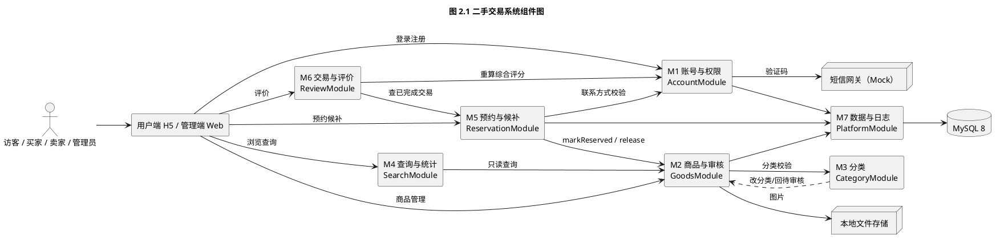

# 实验二 执行计划（二手交易系统 · 软件设计与建模）

> 核对时间：2026-11-11　做的对象：`实验2_241220143_王彦君`
> 输入：`实验二\2.md`（任务书 + 两份范例）、`实验1_241220143_王彦君\requirements.md`（35 条需求）、`report.pdf`（七模块划分 + 7+7 状态机）
> 目标产物：`实验报告.pdf` + `UML\`（8 组 puml/png）+ `UI界面\`（13 张 png），打包 `实验2_241220143_王彦君.zip`

---

## 0. 一句话结论

用实验一的 7 个业务模块当组件边界，先把"**状态机 + 事务 + 唯一约束**"三条设计主线定死，再出 **8 张 UML 图**（三类全覆盖，类图必画）与 **13 屏 UI**，最后按 5 章写报告。本机工具链今天已实测可跑：PlantUML 官方服务器出图（中文正常）、Chrome 无头截图出 UI 稿、XeLaTeX 出报告 PDF。**2 天可交付，1 天可交最低版本。**

---

## 1. 任务书拆解：每条要求 → 一个交付物

| # | 任务书要求 | 出处 | 对应交付物 | 现状 |
|---|---|---|---|---|
| R1 | 描述软件整体架构、模块划分（**必须包含实验一的基本要求模块**）与模块间交互 | §二 | 组件图 + 模块交互矩阵 + 设计理由表 | 待做 |
| R2 | 类图**必画**；结构/行为/交互三类各至少 1 种；**全文 ≥4 种 UML 图**，且标明图名 | §二 | 8 张 puml + png，文件名即图名 | 待做 |
| R3 | UML 图用 **PlantUML** 绘制 | §二 | `UML\*.puml` 源码一并提交 | 待做 |
| R4 | 为**每个功能模块**设计 UI，并配文字说明 | §二 | 13 张 png + 报告第 3 章逐屏描述 | 待做 |
| R5 | 报告必须含：①软件的主要功能 ②架构 UML 图（含逻辑关系与**这样设计的原因**）③各模块 UI 及功能描述 | §三-1 | 报告第 1/2/3 章 | 待做 |
| R6 | 单列一章写 AI 辅助：场景、生成结果、优缺点、修改优化后的结果；结尾总结"大模型如何辅助软件设计" | §二 | 报告第 4 章 | 待做 |
| R7 | **报告书写不允许使用大模型辅助** | §二 | — | **红线** |
| R8 | 报告开头先清晰说明所选项目 | §五 | 报告 §1.1 | 待做 |
| R9 | 交付结构固定：`实验报告.pdf` / `UML\` / `UI界面\` | §三-2 | 目录 + zip | 待做 |

**两处必须先看清楚的坑：**

1. **截止日期是旧文件残留。** `2.md` 写的是"2025 年 10 月 31 日"，今天是 2026-11-11，那份 md 是从上一年的任务书复制的（范例日期也都是 2024/2025）。按课程周历，实验 3 的课堂时间已过，实验 2 大概率**已到期或就在这两天**——**先问助教确切时间，再决定走"2 天完备版"还是"1 天最低版"。**
2. **范例的下限很低。** 成华睿 6 图 3 屏、刘姝俐 4 图 7 屏，都是刚好达标。本方案 8 图 13 屏属于任务书鼓励的"完备、美观、实用（额外给分）"区间；若时间只剩 1 天，砍到 5 图 8 屏仍然达标（见 §10）。

---

## 2. 输入梳理：实验一给了什么，实验二要接住什么

实验一已经把"设计所需的全部事实"写完了，实验二不是重新想需求，而是**把需求翻译成结构**。这层对应关系决定了后面每张图画什么。

| 实验一的产出 | 直接变成实验二的 | 用在哪 |
|---|---|---|
| 七模块划分：账号与权限 / 商品与审核 / 分类 / 查询与统计 / 预约与候补 / 交易与评价 / 数据与日志 | 组件图的 7 个组件（R1 要求的"必须包含实验一基本要求模块"就是这 7 个，一个不能少） | 组件图、包图、报告 §2.1 |
| 35 条需求（REQ-001～035，编号唯一） | 用例 → 用例图；字段 → 类图；控件 → UI；约束 → 数据库设计 | 全篇 + 追溯表 |
| 商品 7 状态 + 预约 7 状态的允许/禁止转换表 | **状态图**（本项目最该画、也最能拉开差距的一张图） | 状态图、GoodsStateMachine |
| 八类数据 + 唯一性约束（REQ-015） | 实体类、关系、唯一索引 | 类图、数据库表设计 |
| 访客/买家/卖家/管理员 + 已注销态 | 用例图 actor | 用例图 |
| 非功能 4 条（REQ-018 性能、019 安全、020 原子性、034 易用性）+ 约束 1 条（REQ-023 日志保留） | 部署图、事务边界、索引、幂等、AOP 日志、UI 步骤数标注 | 部署图 + §5.4 + §7.2 |

**追溯自检：** 7 个模块对上 35 条需求，6+7+2+3+10+2+5 = 35，一条不漏（见 §4.1 表）。

---

## 3. 设计决策（先定框架，图才有内容）

### 3.1 系统形态

- **一套后端，两端界面**：普通用户端为移动 H5（画幅 390×844），管理端为桌面 Web（1440×900）。
  - 理由：预约主流程要求"≤5 个界面步骤、手动操作 ≤4 次"（REQ-034），移动端画幅天然适合逐步标注；而管理端的审核台、统计、日志是表格密集型，桌面画幅才放得下。一套 Vue 代码按角色路由分发，实验三只写一遍。
- **分层**：Controller → Service（领域服务 + 状态机）→ Repository → MySQL；图片落本地磁盘 + 静态资源映射；短信走 `SmsSender` 接口（课程环境用 Mock 实现，返回固定验证码，接口留真实网关位置）。

### 3.2 技术栈（推荐 + 备选，选哪个决定实验三的工作量）

| 层 | 推荐 | 轻量备选 | 为什么这么选（报告里要写） |
|---|---|---|---|
| 后端 | Java 17 + Spring Boot 3 + MyBatis-Plus | Python + FastAPI + SQLAlchemy | REQ-020 要事务原子性、REQ-012 要行锁与唯一索引、REQ-017 要 AOP 统一记录成功/失败日志——这三件事在 Spring 里都是现成的；且 Controller/Service/Mapper 三层正好喂饱包图与时序图 |
| 数据库 | MySQL 8 | SQLite | 需要**生成列 + 唯一索引**表达"同一商品最多一条有效预约"（§5.2），SQLite 也能做但要绕 |
| 前端 | Vue 3 + Vite + Element Plus（管理端）/ Vant（用户端） | 纯 HTML+fetch | 组件化让"每个模块的 UI"与代码一一对应，实验三能直接演进 |
| 建模图 | PlantUML（官方服务器渲染，无需装 Java） | 本地 `plantuml.jar`（需 JDK） | 任务书指定 PlantUML；本机无 Java，用服务器渲染已实测可用（§9） |
| UI 稿 | Figma / 墨刀 / 亿图 正式重绘；HTML+CSS 稿作 1:1 参照 | 仅 HTML 稿 | 任务书说"UI 设计工具可以使用亿图图示等"，见 §7.3 合规提醒 |
| 报告 | XeLaTeX（ctexart），沿用实验一的 `report.tex` 骨架 | Word 导出 PDF | 实验一已验证可编译；9 张图 + 13 屏图排版可控 |

**明确不选：** 纯前端 mock（实验三要 500 行以上可运行原型，设计必须能落地）；微服务（单库事务就能满足 REQ-020，拆开只会让"原子性"变难）。

### 3.3 沿用实验一的"不实现"边界

真实支付、物流地址、在线聊天、议价、推荐、评价修改删除、分类删除——设计图上**不出现**这些，避免评审时被问"需求里没有你为什么画"。

---

## 4. 模块划分与交互（组件图与"设计原因"的原始材料）

### 4.1 七个模块

| # | 设计模块 | 实验一模块 | 覆盖需求 | 职责一句话 |
|---|---|---|---|---|
| M1 | 账号与权限 AccountModule | 账号与权限 | 001 002 019 031 032 033 | 注册登录、短信验证、改手机号、注销、连续失败锁定 |
| M2 | 商品与审核 GoodsModule | 商品与审核 | 003 004 005 006 007 022 027 | 草稿→提交→审核→上下架的完整生命周期、图片规则 |
| M3 | 分类 CategoryModule | 分类 | 028 029 | 分类增改停用，及"管理员改分类→回待审核"的联动 |
| M4 | 查询与统计 SearchModule | 查询与统计 | 008 016 018 | 四条件组合查询、按角色裁剪可见范围、分类统计 |
| M5 | 预约与候补 ReservationModule | 预约与候补 | 009 010 011 012 013 021 024 030 034 035 | 唯一有效预约、候补递补、联系方式可见性、交易完成 |
| M6 | 交易与评价 ReviewModule | 交易与评价 | 025 026 | 完成后双向互评、综合评分聚合（0 条显示"无"） |
| M7 | 数据与日志 PlatformModule | 数据与日志 | 014 015 017 020 023 | 价格校验、一致性约束、操作日志、事务与幂等、保留期 |

### 4.2 模块交互矩阵（组件图旁必须配这张表，回答"模块之间怎么交互"）

| 调用方 → 被调用方 | 接口/事件 | 为什么需要这条依赖 |
|---|---|---|
| M2 → M3 | `categoryName(id)`、`enabledCategories()` | 商品必须挂分类，且只能选启用中的分类（REQ-003/028） |
| M2 → M7 | `log(...)`、`@Transactional` | 提交/通过/驳回/下架都要留痕，且状态变更要原子（REQ-017/020） |
| M3 → M2 | `resetToPending(goodsId)` | 管理员改分类视同内容变更，商品回待审核（REQ-029） |
| M4 → M2 | `query(view, filter)` | 查询是商品只读视图 + 按角色裁剪（REQ-008） |
| M5 → M2 | `markReserved()` / `release()` / `violateInvalidate()` | 预约成功必须**同一事务内**把商品改为已预约；取消/拒绝/作废要放开（REQ-011/035） |
| M5 → M1 | `checkContactReady(buyerId, sellerId)` | 双方未填手机号时拒绝预约（REQ-009） |
| M5 → M7 | `idempotent(requestId)`、`log(...)` | 重复提交返回首次结果；取消/确认/完成都记录日志（REQ-013/017） |
| M6 → M5 | `findCompleted(reservationId)` | 只有已完成的交易才能评价（REQ-025） |
| M6 → M1 | `recalcCredit(userId)` | 新评价即时重算被评价人综合评分（REQ-026） |
| M4 → M7 | `log(...)`、`stat(...)` | 管理员查询日志与统计（REQ-016/017） |
| 全部 → M1 | `currentUser()`、`authorize(role, action)` | 越权统一在入口拦截（REQ-002） |

> 这张表就是报告 §2.1 的正文：**"逻辑关系"**=调用了什么接口，**"这样设计的原因"**=右列。

### 4.3 每个模块为什么单独成模块（报告 §2.9 直接用）

| 模块 | 单独成模块的理由 | 依赖方向为什么是单向的 |
|---|---|---|
| M1 账号 | 三类角色与"已注销态"是所有权限判断的入口，收敛在一处才不会出现越权 | 被所有人依赖，自己不依赖业务模块 |
| M2 商品 | 商品状态机是全系统最大的状态集合（7 态），审核流程只属于它 | 只依赖分类与平台，不反向依赖预约 |
| M3 分类 | 生命周期极短但**反向触发**商品回待审核，独立后才能保证联动不被漏 | 只在"改分类"这一个动作上反向调用 M2 |
| M4 查询 | 纯读、有性能指标（REQ-018），需要独立优化索引与缓存 | 只读 M2，不写任何业务数据 |
| M5 预约 | 唯一性、幂等、并发、原子性四条硬约束全在这里，是本项目的复杂度中心 | 向下改商品状态、向上取账号信息，必须双向但都经接口 |
| M6 评价 | 依赖"交易已完成"这一前置，且要算聚合分（REQ-026） | 只读 M5，不反向影响交易 |
| M7 平台 | 横切关注点（日志/事务/幂等/校验）不属于任何业务模块 | 被所有模块依赖，不含业务规则 |

---

## 5. 类模型（类图与数据库设计的唯一来源）

### 5.1 实体（9 个类 ≈ 9 张表）

| 实体 | 关键字段 | 说明 / 对应 REQ |
|---|---|---|
| `User` 用户 | id, username, passwordHash, phone, role, status, failCount, lockUntil, createdAt, cancelledAt | 密码单向摘要、5 次锁 10 分钟（019）；注销只打标记（033） |
| `Category` 分类 | id, name, enabled, sortNo | 只停用不删除（028） |
| `Goods` 商品 | id, sellerId, categoryId, title, description, price, status, rejectReason, violationReason, publishedAt, completedAt | price 精度 2 位且 >0（014）；7 状态（005） |
| `GoodsImage` 图片 | id, goodsId, url, sizeBytes, contentType, sortNo | 0–12 张、≤5MB、jpg/png（027） |
| `Reservation` 预约 | id, goodsId, buyerId, status, extraContact, requestId, createdAt, confirmedAt, completedAt | 联系方式"预约时另填"放这里，不再单开实体（024） |
| `WaitlistEntry` 候补 | id, goodsId, buyerId, position, createdAt | 顺位唯一且连续，递补用（030） |
| `Review` 评价 | id, reservationId, reviewerId, revieweeId, score, comment, createdAt | 关联**交易（预约）**而非商品（025） |
| `OperationLog` 日志 | id, operatorId, action, targetType, targetId, result, failReason, createdAt | 失败也要记（017） |
| `SmsCode` 验证码 | id, phone, code, purpose, expireAt, usedAt | 注册/改号双验证（031/032） |

> 实验一 §4.2 曾指出"REQ-024 要填联系方式但数据模型里没有字段"——本设计用 **`User.phone`（默认）+ `Reservation.extraContact`（预约时另填）** 补上，这是类图上要专门标一笔的地方，也是报告里"从需求缺口中推导设计"的好素材。

### 5.2 关系与唯一约束怎么落到库里

| 约束（REQ-015） | 落地方式 |
|---|---|
| 同一商品最多一条有效预约（012） | `status IN ('待卖家确认','已确认')` 算有效；加**生成列** `active_flag`（有效=1，其他=NULL）+ `UNIQUE(goods_id, active_flag)`；写预约时 `SELECT ... FOR UPDATE` 锁商品行 |
| 商品已预约 ⇒ 必须有且仅有一条有效预约（015/020） | 商品状态变更与预约写入在**同一 `@Transactional`** 内完成，失败整体回滚（020） |
| 同一买家对同一商品最多一条待处理候补 | `UNIQUE(goods_id, buyer_id, status_of_wait)`；顺位 `UNIQUE(goods_id, position)` |
| 同一交易同一评价人一条 | `UNIQUE(reservation_id, reviewer_id)` |
| 重复提交幂等（013） | `UNIQUE(request_id)` + 命中时回放首次结果快照 |
| 用户名/手机号唯一 | `UNIQUE(username)`、`UNIQUE(phone)`（注销后释放：置 NULL 或换占位） |

### 5.3 领域服务与状态机（类图第二区：实体之外的"行为"）

| 类 | 方法 | 说明 |
|---|---|---|
| `GoodsStateMachine` | `canTransit(from, action)` / `next(from, action)` | 用枚举 + 转移表固化 REQ-005 的允许/禁止转换；非法转换抛 `IllegalTransitionException` |
| `ReservationStateMachine` | 同上 | 固化 REQ-009～013/021/030 的预约状态转换 |
| `AuthService` | register / login / sendCode / changePhone / cancelAccount | 含锁定与解锁判断 |
| `GoodsService` | saveDraft / submit / approve / reject / offShelf / violate / modify | 委托状态机 |
| `ReservationService` | reserve / cancel / refuse / confirm / complete / promoteFromWaitlist | 核心：锁行 → 校验 → 写预约 → 改商品 → 记日志 |
| `ContactService` | `canView(userId, reservationId)` | 按"当前是否存在有效预约且本人为双方"**实时**判定，不落冗余标记（024） |
| `ReviewService` | review / `recalcCredit(userId)` | 聚合平均，0 条返回 `null` → 前端显示"无"（026） |
| `LogService` | `record(...)` with `REQUIRES_NEW` | 独立事务，业务回滚也留痕（017/020） |
| `IdempotencyService` | `tryBegin(requestId)` | 幂等登记与结果快照（013） |

### 5.4 五个关键设计点（报告正文的重点，也是评分的眼）

1. **状态机集中化**：7+7 个状态、每条转换都来自需求表。把"能不能转"从散落各处的 if 收进 `xxxStateMachine`，测试用例就是需求表本身（REQ-005 的验收方法可以直接跑）。
2. **有效预约唯一靠库不靠代码**：`UNIQUE(goods_id, active_flag)` 是最后一道防线；应用层用 `FOR UPDATE` 先锁再判，两道保险应对 REQ-012 的并发场景。
3. **事务边界写在一处**：预约创建/取消/确认/完成与商品状态变更共用一个事务，日志走 `REQUIRES_NEW`——这正好是可验收的 REQ-020。
4. **联系方式的可见性是"算出来的"**：不存 `canView` 字段，每次按当前有效预约判断，取消/拒绝/作废后自动失效，天然满足 REQ-024 的"立即不可见"。
5. **幂等表 + 结果快照**：REQ-013 要求"重放返回第一次的结果"，所以幂等记录里存的是结果快照而不只是一个标记。

（另两条次要：价格用 `DECIMAL(10,2)` + 应用层二次校验（014）；综合评分实时聚合或物化，0 条必须显示"无"而不是 0.0（026）。）

---

## 6. UML 图清单：8 张（+1 选做）

任务书要求"三类各≥1，全文≥4 种"；下表 8 张覆盖 **结构 4 / 行为 3 / 交互 1**，安全过线且有明显加分空间。

| # | 文件（=图名） | 类别 | 图要表达什么 | 为什么选它 |
|---|---|---|---|---|
| 1 | `UML类图.puml` | 结构性 | 9 个实体 + 5 个服务/状态机、关系与关键约束注解 | **任务书硬性要求**；也是数据库设计的依据 |
| 2 | `UML组件图.puml` | 结构性 | 7 个模块、对外端口（API/DB/文件/短信）、依赖方向 | 任务书要求"模块划分 + 模块间交互"，组件图是**最直接**的表达 |
| 3 | `UML包图.puml` | 结构性 | 后端分层包（controller/service/domain/mapper/config）+ 前端包（views/api/store） | 把"分层架构"落成可检查的目录结构，实验三照此建工程 |
| 4 | `UML部署图.puml` | 结构性 | 浏览器 → Nginx 静态站 → 应用 → MySQL / 本地文件 / 短信网关 | 回答 REQ-018 的性能落点与 REQ-023 的日志存储位置 |
| 5 | `UML用例图.puml` | 行为性 | 4 个 actor（访客/买家/卖家/管理员）× 7 个用例包，含 include/extend | 三类角色权限边界（REQ-002）一张图讲完 |
| 6 | `UML活动图.puml` | 行为性 | 卖家发布→审核→预约→确认→完成的**主流程**，含驳回/取消/违规三条回退分支，用泳道区分三方 | 主流程 + 异常分支一眼看清，对应实验一 §2.2 |
| 7 | `UML状态图.puml` | 行为性 | 商品 7 态（一张）+ 预约 7 态（一张子图） | **本项目最有价值的一张**：状态与合法转换是需求的核心，也是最容易被评审追问的点 |
| 8 | `UML时序图.puml` | 交互性 | 场景 A：买家预约（含并发失败 + 加入候补）；场景 B：卖家取消 → 候补自动递补 | 展示"锁行→写预约→改商品→记日志"的事务时序，把 §5.4 的三个设计点画实 |
| 9 | `UML通信图.puml`（选做） | 交互性 | 与场景 A 相同的对象协作，用编号 1..n 表达顺序 | 与 8 形成"时序/协作"对照，多一种图多一点分 |

**每张图的画法要点（避免返工）：**

- 文件名就用中文图名（`UML类图.puml`），任务书范例就是这么交的，且报告里可直接引用同一名字。
- 所有图第一行写 `title 图 x.y 图名`，统一 `skinparam defaultFontName "Microsoft YaHei"`、`skinparam backgroundColor #FFFFFF`，保证 8 张风格一致、打印不发灰。
- 类图里**必标**三处：`User.phone` + `Reservation.extraContact`（补 REQ-024 缺口）、`Goods.active_flag`（唯一预约）、`Review` 关联 `Reservation` 而非 `Goods`（REQ-025 的交易口径）。
- 状态图必须把**禁止的转换**用注释或红色虚线标出来（实验一已列出"未列出的都拒绝"），这是评审最想看到的严谨性。
- 时序图只用 6–8 条生命线，不要把所有类都铺进去；`alt` 分支写"已有有效预约 → 加入候补"。
- 每张图的 png 由 puml 直接渲染，**不要手工改图**，否则 puml 与 png 对不上，任务书要求两个文件都交。

---

## 7. UI 清单：13 屏（每个模块都有，且都对应可验收的需求）

| # | 文件 | 所属模块 | 关键控件 | 覆盖 REQ |
|---|---|---|---|---|
| 01 | `01-登录注册.png` | 账号与权限 | 用户名/密码/手机号/验证码倒计时、锁定提示条、"管理员账号不可注册"说明 | 001 019 031 |
| 02 | `02-个人中心.png` | 账号与权限 | 手机号修改（新旧双验证码）、注销入口（未完成交易时置灰+原因） | 032 033 |
| 03 | `03-首页商品列表.png` | 查询与统计 | 搜索框、分类 chips、价格区间、状态筛选、商品卡（价格/卖家评分角标/状态徽标）、空态 | 008 018 |
| 04 | `04-商品详情.png` | 商品与审核 | 图片轮播（12 张缩略）、价格、卖家信息 + 综合评分（"无"态）、预约按钮、候补按钮、驳回原因仅卖家可见 | 022 024 026 |
| 05 | `05-预约确认.png` | 预约与候补 | 默认手机号（只读）、"另填联系方式"、提交按钮；页面右下标注 **①②③④ 操作计数** | 009 024 034 |
| 06 | `06-我的预约-买家.png` | 预约与候补 | tab（待确认/已确认/已完成/已失效）、联系对方卡片、取消按钮（已确认后置灰） | 010 011 021 |
| 07 | `07-我的预约-卖家.png` | 预约与候补 | 确认/拒绝、联系买家、**候补队列与顺位**、递补提示 | 011 030 |
| 08 | `08-卖家商品管理.png` | 商品与审核 | 7 状态 tab、草稿/待审核/已发布行内操作（提交/撤回/下架）、驳回原因、有预约时编辑置灰 | 003 004 006 022 |
| 09 | `09-商品编辑.png` | 商品与审核 | 标题、分类下拉（仅启用）、价格（两位小数实时校验）、描述、12 图上传（5MB / jpg|png 提示） | 014 027 |
| 10 | `10-管理员审核台.png` | 商品与审核 | 待审核列表、图片预览、通过 / 驳回（必填原因弹层） | 004 007 |
| 11 | `11-管理员分类管理.png` | 分类 | 分类列表、新增、改名、启停开关（停用后已发布商品仍展示的说明） | 028 029 |
| 12 | `12-管理员统计与日志.png` | 查询与统计 + 数据与日志 | 各分类已发布数、近 30 天完成数；日志筛选（操作者/时间范围/类型/结果）与表格 | 016 017 023 |
| 13 | `13-交易完成与评价.png` | 交易与评价 | 确认完成（含二次确认）、评价弹层（1–5 星 + 文字）、评价后用户主页评分刷新 | 011 025 026 |

### 7.1 视觉规范（写进报告 §3 开头，风格统一才好看）

- 主色 `#FF6B35`（活力橙，二手交易的"捡漏"感），文字 `#1F2329`，背景 `#F5F6F8`，分割线 `#E8EAED`；语义色：成功 `#2E9E5B`、警告 `#F2B01E`、危险 `#E5484D`、待审核 `#3B82F6`。
- 字号 32/24/18/16/14/12；8px 栅格；卡片圆角 12、阴影 `0 8px 24px rgba(0,0,0,.06)`。
- 用户端画幅 390×844（@2x 出图 780×1688）；管理端 1440×900。
- 每屏必须有：状态徽标（7 态配色统一）、空态、错误提示位置（REQ-034 要求失败时停留在当前步骤且不丢已填内容 → 界面上要画出来）。
- 管理端 12 号屏把"统计"和"日志"放一屏两栏，省一张图但功能不缺。

### 7.2 预约链路的"5 步 / 4 次操作"标注（REQ-034 的可验收证据）

`03 首页` → 点商品卡（①）→ `04 详情` 点"预约"（②）→ `05 预约确认` 填联系方式后提交（③）→ 结果页查看"等待卖家确认 / 你的候补顺位 N"（④）。在 `05` 与结果页图上用 ①②③④ 圈号标出来，并在报告里写一句"界面步骤 5、手动操作 4、必填 1，满足 REQ-034"。这是把非功能需求"画出来"的地方，评审很吃这一套。

### 7.3 关于"UI 设计工具"的合规提醒（必须你自己定）

任务书原话是"UI 设计工具可以使用亿图图示等绘制工具"。本机可用的出图路径是 **HTML+CSS → Chrome 无头截图**（今天已实测，中文与阴影都正常），它出的是像素级视觉稿，但严格说不是"设计工具"。

- **稳妥做法**：我给出每屏的布局尺寸、色板、控件清单与文案，你在 Figma / 墨刀 / 亿图 里按 1:1 重绘（一屏 10–20 分钟），报告里如实写工具名；
- **赶时间的做法**：直接用 HTML 稿交付，报告"工具"一栏如实写"HTML/CSS 原型稿 + Chrome 渲染导出"，不虚构工具名（虚构被发现比不用工具更严重）。
- 无论哪种，**AI 生成的界面稿都要记进报告第 4 章**（R6），这是明规则。

---

## 8. 报告结构（5 章，14–18 页）

| 章 | 节 | 内容要点 | 页 |
|---|---|---|---|
| 封面 | — | 课程/实验名、学号姓名 241220143 王彦君、日期 | 0.2 |
| 目录 | — | 自动生成 | 0.8 |
| **1 软件的主要功能** | 1.1 项目说明 | **先说清选了什么项目**（校园二手交易，解决"口头订下、先后无记录"，不碰支付）| 0.6 |
| | 1.2 主要功能 | 6 条一句话功能（发布审核／分类／查询统计／预约候补／交易评价／日志） | 0.9 |
| | 1.3 功能模块 | 7 模块表 + 每条需求挂到模块（§4.1） | 0.8 |
| **2 软件架构 UML 图** | 2.1 模块划分与交互 | 组件图 + §4.2 交互矩阵 + §4.3 设计理由 | 2.5 |
| | 2.2 包图 | 分层与目录结构 | 1.0 |
| | 2.3 类图 | 实体/服务图 + §5.2 约束表 + 三处必标点 | 2.5 |
| | 2.4 状态图 | 商品 7 态 + 预约 7 态，禁转写明 | 1.5 |
| | 2.5 用例图 | 4 actor、include/extend 说明 | 1.0 |
| | 2.6 活动图 | 主流程 + 3 条回退分支 | 1.2 |
| | 2.7 时序图 | 场景 A/B，标注事务边界 | 1.5 |
| | 2.8 部署图 | 部署节点 + REQ-018/023 的落点 | 0.8 |
| **3 各模块 UI 及功能描述** | 3.1 设计规范 | 色板、栅格、画幅 | 0.5 |
| | 3.2–3.8 逐模块 | 13 屏，每屏"相关模块 / 功能描述 / 对应需求"三行（照范例格式） | 5.5 |
| **4 大模型辅助设计的使用记录** | 4.1–4.4 | 4 条使用记录（见下）；每条**使用场景 / 生成结果 / 优缺点分析 / 修改优化后的结果** | 2.5 |
| | 4.5 总结 | 大模型能辅助什么、不能替代什么 | 0.6 |
| **5 总结与遗留** | — | 设计取舍、与实验三的接口、TODO | 0.6 |
| 附录 | A/B | 数据库表结构、需求-模块-UI 追溯表 | 1.5 |

**第 4 章的 4 条记录（必须真实发生、包含"我的修改"）：**

| 记录 | 使用场景 | 生成结果的问题（写细节） | 我的修改 |
|---|---|---|---|
| A1 模块划分 | 让模型按 35 条需求给 3 种模块划分方案 | 模型按"前端/后端/数据库"分层，与任务书要求的"业务模块"口径不一致 | 改成按实验一的 7 个业务模块，把日志/事务降为横切模块 M7 |
| A2 PlantUML 代码 | 类图 / 时序图骨架 | 首次生成的类图**漏了"有效预约唯一"的表达**，且把评价关联到商品而非交易 | 补 `active_flag` 与 `Review.reservationId`，改 4 处多重度 |
| A3 UI 控件方案 | 预约弹层、状态徽标 | 建议把联系方式、议价、聊天都塞进弹层 → 违反"≤4 次操作"与"不做在线聊天" | 删到 1 个必填项，操作计数 4 次，画出 ①②③④ |
| A4 设计评审 | 让模型扮演评审挑漏洞 | 提出"两人同时预约怎么保证只有一条"是我没写的地方 | 采纳为 §5.2 的生成列唯一索引 + 行锁 |

**红线：** 报告正文（含第 4 章的分析文字）**必须自己写**（R7）；可以引用 AI 生成的图与代码片段，但"为什么这样设计"的判断和语句要出自本人。第 4 章若不记录本方案里 AI 生成的 8 张 puml、13 屏稿，属于"用了但不记"，风险高于不用。

---

## 9. 工具链与执行步骤（今天已逐项实测）

| 工具 | 本机状态 | 实测结论 |
|---|---|---|
| PlantUML 官方服务器 | 联网可用 | `~h` UTF-8 十六进制 GET 能出中文图；但 URL 过长（>8KB）返回 400 |
| deflate+base64 客户端编码 | 已写 `puml2png.mjs` | 20 个类的中文类图渲染成功（68KB PNG），无需装 Java |
| Chrome / Edge 无头截图 | `C:\Program Files\Google\Chrome\Application\chrome.exe` | HTML → PNG 正常，中文/阴影/圆角都对 |
| XeLaTeX + ctex | `E:\texlive\2026\bin\windows\xelatex.exe` | 实验一报告即由它产出，可复用 `report.tex` 骨架 |
| pdftotext | TeXLive 自带 | 用于校对 PDF 文字（查乱码/掉字） |

**Step 0　建目录**

```
实验2_241220143_王彦君\
├── 实验报告.pdf
├── UML\      （8 组 puml + png）
└── UI界面\    （13 张 png）
```

**Step 1　写 8 个 .puml**（每个文件都以 `@startuml ... @enduml` 包裹，UTF-8 编码）

组件图骨架（**已实测渲染通过**，可直接用；其余 7 张按 §6 规格展开）：



> 排版经验（省你反复调）：`left to right direction` 是本图可读性的关键；**不要再加 `package` 包一层**——包标题会压在 M1 的框线上（已试过 `packageStyle folder/rectangle` 均无效）。"7 个模块同属一个单体应用"这件事写在图题与正文里即可。

**Step 2　渲染 PNG**（`puml2png.mjs` 已生成在 `.build\tools\`，逻辑：deflateRaw + PlantUML 自定义 base64 → GET 官方服务器；语法错误会另存 `*.error.png` 并报出行号）

```powershell
node .build\tools\puml2png.mjs '实验2_241220143_王彦君\UML'
```

> 失败时的排查顺序：① 看 `*.error.png`（服务端把错误行画在图上）② 常见错因：`{` 后必须换行、类名含空格要加引号、`skinparam` 拼错。③ 断网时改在 plantuml.com 网页版粘源码导出，或装 JDK 后用 `java -jar plantuml.jar -charset UTF-8 UML\*.puml`。

**Step 3　生成 UI 稿**（每屏一个独立 html，用固定画幅截图）

```powershell
& 'C:\Program Files\Google\Chrome\Application\chrome.exe' --headless=new --disable-gpu `
  --hide-scrollbars --force-device-scale-factor=2 --window-size=390,844 `
  --screenshot="实验2_241220143_王彦君\UI界面\05-预约确认.png" `
  "file:///F:/A-大三上/软件工程/.build/ui/05.html"
# 管理端把 --window-size 改 1440,900、--force-device-scale-factor 去掉
```

**Step 4　出报告 PDF**：复制实验一的 `report.tex` 作骨架 → 加 `\usepackage{graphicx}` 与图片路径 → 每张图用 `figure` + `\caption` 编号 → `xelatex` 两遍（需目录）。13 屏 UI 用两列 `minipage` 排，约 6 页。

**Step 5　打包自检**

```powershell
cd 'F:\A-大三上\软件工程'
Compress-Archive -Path '.\实验2_241220143_王彦君' -DestinationPath '.\实验2_241220143_王彦君.zip' -Force
```

---

## 10. 时间表

**2 天完备版（8 图 13 屏）**

| 时段 | 任务 | 里程碑 |
|---|---|---|
| D1 上午 | Step 0–1：8 个 puml（先类图、状态图这两张最难的） | 源码齐 |
| D1 下午 | Step 2 渲染 + 逐张改错；同时定 UI 视觉规范 | 8 张 PNG 全绿 |
| D1 晚上 | Step 3：13 屏 HTML 稿 → 截图 | UI 目录齐 |
| D2 上午 | Step 4：报告 §1–§3（图与文字互相对齐，每图必配"为什么这样设计"） | 正文 12 页 |
| D2 下午 | 报告 §4 AI 记录 + §5 + 附录；PDF 编译两遍 | 实验报告.pdf |
| D2 晚 | Step 5 打包 + §11 自检 | zip 交付 |

**1 天最低版（若截止就是今晚）**：砍到 5 张图（类图/组件图/用例图/状态图/时序图）+ 8 屏（03/04/05/06/08/10/11/12），报告压到 10 页，第 4 章写 2 条记录。仍然满足"三类各≥1、≥4 图、每模块有 UI"。

---

## 11. 提交前自检清单

- [ ] 图 ≥4 种且**类图在内**，三类（结构/行为/交互）各至少 1 张，每张图上有图名
- [ ] `UML\` 里每个 `.puml` 都有**同名** `.png`，没有 `*.error.png` 残留
- [ ] 7 个业务模块在组件图里一个不少（对应实验一）
- [ ] 每张图在正文都有"这张图说明什么 + 为什么这样设计"，不是只放图
- [ ] 13 屏 UI 每张都有"相关模块 / 功能描述"，且能指到具体 REQ 编号
- [ ] 报告**开头**写明所选项目与范围
- [ ] 第 4 章 4 条记录齐全（场景/生成/优缺点/修改后），且**真实**
- [ ] 报告正文为自己撰写（R7）
- [ ] 目录正确、图号连续、页脚页码、无"如图"空指
- [ ] 包名 `实验2_241220143_王彦君.zip`，解压后一级目录同名
- [ ] 用 `pdftotext` 抽查 PDF：中文无乱码、无掉字、表格不越界

---

## 12. 需要你定的 4 件事

1. **截止时间**：任务书里的 2025-10-31 是旧文件，实际几号？决定走 2 天版还是 1 天版。
2. **技术栈**：Spring Boot + MySQL（推荐，实验三顺）还是 FastAPI + SQLite（更快起步）？
3. **平台形态**：用户端 H5 + 管理端桌面（推荐）／全部桌面 Web／全部移动端？
4. **UI 稿的产出方式**：设计工具重绘（合规最稳）还是 HTML 稿直接交付（最快，需如实写工具）？

> 定完这 4 项，我就按 §6 / §7 一次性把 8 个 puml 写完并渲染、把 13 屏 HTML 稿写完并截图，最后拼出 `report.tex` 的报告骨架（正文留给你写）。
